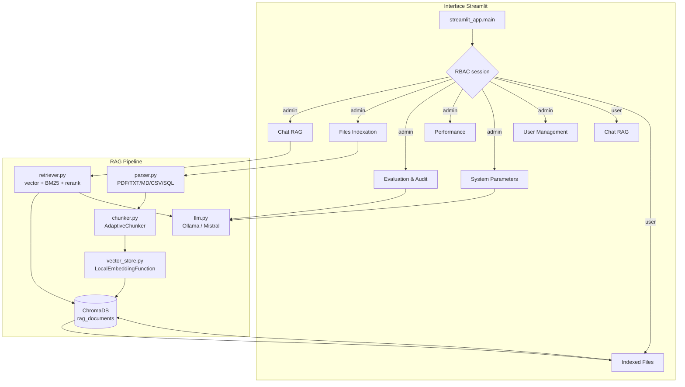

# Étude de Conception — RAG Souverain

> Document de conception technique du système **RAG Souverain**.
> Version 1.0 — Document vivant (à mettre à jour avec chaque évolution majeure).

---

## 1. Vue d'ensemble

**RAG Souverain** est un système de *Retrieval-Augmented Generation* **100 % local et
isolé réseau**. Il ingère des documents d'entreprise hétérogènes (PDF natifs et scannés,
TXT, Markdown, CSV, bases SQLite), les découpe en chunks, les vectorise avec un modèle
d'embedding **hors-ligne**, les indexe dans **ChromaDB** (persistance locale), puis répond
à des questions en langage naturel via un LLM **open-source** exécuté localement (Ollama /
Mistral).

Les trois principes fondateurs :

1. **Souveraineté** — aucune donnée ne quitte l'infrastructure : embeddings locaux, LLM
   local, réseau sortant bloqué par `iptables`, DNS forcé sur `127.0.0.1`.
2. **Contrôle d'accès** — authentification + RBAC à deux rôles (`admin` / `user`).
3. **Traçabilité** — chaque réponse est sourcée (fichier, page, score), les requêtes sont
   journalisées et l'ensemble est évalué (pipeline Ragas).

---

## 2. Contexte et objectifs

| Objectif | Description |
|---|---|
| O1 | Pipeline d'ingestion automatique de documents PDF, TXT, MD, CSV et SQL. |
| O2 | Chunking adaptatif selon le type de document (sections, fenêtre glissante, tableaux, SQL). |
| O3 | Vectorisation locale et indexation dans une base vectorielle persistante. |
| O4 | Génération de réponses par un LLM local (Mistral via Ollama) avec citations des sources. |
| O5 | Interface de gestion complète avec authentification et rôles. |
| O6 | Évaluation scientifique (Ragas) et auditabilité des requêtes. |

---

## 3. Exigences fonctionnelles

| ID | Exigence |
|---|---|
| FR-01 | L'utilisateur s'authentifie avec un nom d'utilisateur et un mot de passe (haché `scrypt`). |
| FR-02 | Le système propose deux rôles : `admin` (toutes les pages) et `user` (chat + fichiers indexés). |
| FR-03 | L'utilisateur pose une question en langage naturel et reçoit une réponse avec les sources citées (fichier, page, score). |
| FR-04 | Les salutations conversationnelles courtes sont détectées et traitées sans recherche vectorielle. |
| FR-05 | L'administrateur indexe plusieurs fichiers en un lot (PDF/TXT/MD/CSV) avec barre de progression consolidée. |
| FR-06 | Le système versionne chaque fichier ré-indexé (chunks marqués par `version`). |
| FR-07 | L'administrateur supprime un fichier de l'index (par fichier) ou purge l'intégralité de la base vectorielle. |
| FR-08 | L'administrateur visualise les fichiers indexés (nom, version, nombre de chunks, date, statut). |
| FR-09 | L'administrateur ajuste les paramètres système : modèle LLM (figé), température, `top_k`, taille de chunk. |
| FR-10 | L'administrateur gère les comptes (création, changement de mot de passe, suppression). |
| FR-11 | L'administrateur lance l'évaluation Ragas (30 questions de référence) et exporte un rapport CSV. |
| FR-12 | Le système journalise les requêtes (utilisateur, question, latence, sources) et expose les métriques de performance. |
| FR-13 | L'historique de conversation est persistant et exportable en PDF. |
| FR-14 | L'ingestion continue (file watcher) indexe automatiquement les fichiers déposés dans `data/documents`. |

---

## 4. Exigences non fonctionnelles

| ID | Exigence | Cible |
|---|---|---|
| NFR-01 | **Souveraineté réseau** | Aucun trafic sortant hors Ollama hôte (`host.docker.internal:11434`) ; DNS local `127.0.0.1` ; HF en mode `OFFLINE`. |
| NFR-02 | **Confidentialité** | Mots de passe jamais en clair ; session authentifiée par jeton ; RBAC côté UI. |
| NFR-03 | **Performance (chat)** | Latence maîtrisée par le modèle local ; réponse streamée ; recherche bornée à `top_k`. |
| NFR-04 | **Robustesse de l'évaluation** | Budget de 30 s par question (`QUERY_TIMEOUT_SECONDS`) ; thread avec timeout ; échec partiel toléré. |
| NFR-05 | **Persistance** | ChromaDB et SQLite dans des volumes montés ; survit aux redémarrages. |
| NFR-06 | **Fiabilité des données** | Métadonnées assainies (dict/list → JSON, `None` → `""`) pour la compatibilité ChromaDB. |
| NFR-07 | **Qualité** | 53 tests unitaires passants ; suite `pytest` reproductible. |
| NFR-08 | **Maintenabilité** | Modules à responsabilité unique ; docstrings ; étude de conception à jour. |
| NFR-09 | **Portabilité** | Python 3.11, dépendances minimales, conteneur Docker Compose. |

---

## 5. Architecture

### 5.1 Diagramme ASCII

```
                        ┌──────────────────────────────────────────┐
                        │             INTERFACE STREAMLIT          │
                        │  streamlit_app.py  (navigation, session) │
                        └───────────────┬──────────┬───────────────┘
                                        │          │
                    ┌───────────────────┼──────────┼────────────────────┐
                    │  RBAC (session.py)│          │  pages/            │
                    │  admin : 6 pages  │          │  user : 2 pages    │
                    └───────────────────┴──────────┴────────────────────┘
                                        │
                 ┌──────────────────────┼──────────────────────┐
                 │ Chat RAG / Indexation│  Paramètres / Eval   │
                 ▼                      ▼                      ▼
        ┌─────────────────┐    ┌─────────────────┐   ┌──────────────────────┐
        │   INGESTION     │    │    RETRIEVAL    │   │  GENERATION + EVAL    │
        │ parser.py       │    │ retriever.py    │   │ llm.py (Ollama)       │
        │ chunker.py      │    │  · vector search│   │ eval_pipeline.py      │
        │ watcher.py      │    │  · BM25 (RRF)   │   │ (Ragas, timeout 30s)  │
        └───────┬─────────┘    │  · rerank       │   └──────────┬───────────┘
                │              └────────┬────────┘              │
                ▼                       ▼                       ▼
        ┌───────────────────────────────────────────────────────────────┐
        │                 INDEXING / vector_store.py                     │
        │   ChromaVectorStore · LocalEmbeddingFunction (hors-ligne)      │
        │   collection: rag_documents · HNSW · cosine                    │
        └──────────────────────────────────────────┬────────────────────┘
                                                   │
                                                   ▼
        ┌───────────────────────────────────────────────────────────────┐
        │  PERSISTANCE  (data/)                                          │
        │   chroma/          → vecteurs + métadonnées (ChromaDB)         │
        │   rag.db           → users, doc_versions, chat_history         │
        │   query_logs.db    → journal des requêtes (observability)      │
        │   documents/       → documents source (lecture seule)          │
        └───────────────────────────────────────────────────────────────┘
```

### 5.2 Diagramme Mermaid



### 5.3 Composants

| Composant | Fichier(s) | Responsabilité |
|---|---|---|
| Entrée UI | `app/streamlit_app.py`, `app/app_ui.py`, `app/css.py`, `app/session.py` | Rendu, navigation, session, styles (thème clair). |
| Authentification | `app/pages/auth.py`, `app/database.py` | Login/logout, hachage `scrypt`, jetons de session. |
| Ingestion | `app/ingestion/parser.py`, `chunker.py`, `watcher.py` | Extraction texte (PDF natif/OCR, TXT, MD, CSV, SQL) et découpage adaptatif. |
| Indexation | `app/indexing/vector_store.py` | Embeddings hors-ligne, ChromaDB persistante, métadonnées assainies. |
| Recherche | `app/retrieval/retriever.py` | Recherche vectorielle, hybridation BM25 (RRF), reranking CrossEncoder. |
| Génération | `app/generation/llm.py` | Client Ollama (Mistral), formatage du prompt RAG. |
| Évaluation | `app/evaluation/eval_pipeline.py` | Dataset doré (30 questions), métriques Ragas, timeout par question, rapport CSV. |
| Observabilité | `app/observability.py` | Journal des requêtes (latence, utilisateur, sources). |

---

## 6. Schéma du stockage vectoriel (ChromaDB)

**Collection unique :** `rag_documents` (partagée entre tous les rôles — la recherche
n'est pas cloisonnée par utilisateur).

**Espace métrique :** HNSW — similarité **cosinus**.

**Embedding :** `sentence-transformers/paraphrase-multilingual-MiniLM-L12-v2` (dim 384),
chargé en mode hors-ligne (`TRANSFORMERS_OFFLINE=1`).

### 6.1 Métadonnées d'un chunk

| Champ | Type | Description |
|---|---|---|
| `source_file` | str | Nom du fichier source (ex. `stage_si_RAG.pdf`). |
| `page_number` | int | Numéro de page (`-1` si non applicable). |
| `chunk_index` | int | Index global du chunk dans le document. |
| `strategy` | str | Stratégie de découpage : `section`, `sliding_window`, `table`, `sql`. |
| `version` | int | Version du fichier indexé (incrémentée à chaque ré-indexation). |
| `ingested_at` | str | Horodatage ISO-8601 UTC de l'indexation. |
| *(métadonnées métier)* | str/int | Champs personnalisés **assainis** : `dict`/`list` → `json.dumps`, `None` → `""`. |

> L'ID de chaque chunk est un `uuid4` ; le texte brut est stocké dans `documents`.

### 6.2 Filtrage et versionnage

- Recherche filtrée par clause `where` (ex. `{"source_file": "doc.pdf"}`,
  `{"version": {"$lte": max_version}}`).
- `search_latest` ne restitue que les chunks de version ≤ `max_version` pour écarter
  les anciennes versions d'un fichier.
- Suppression par source : `delete_by_source(source_filename)` retire tous les chunks
  d'un fichier (utilisé par les boutons « Delete File »).

---

## 7. Matrice des rôles (RBAC)

Rôles : `admin`, `user`.

### 7.1 Pages accessibles

| Page | `admin` | `user` |
|---|---|---|
| Chat RAG | ✅ | ✅ |
| Files Indexation (upload, purge) | ✅ | ❌ |
| Indexed Files (consultation) | ✅ (dans Files Indexation) | ✅ |
| Evaluation & Audit | ✅ | ❌ |
| Performance | ✅ | ❌ |
| System Parameters | ✅ | ❌ |
| User Management | ✅ | ❌ |

### 7.2 Actions

| Action | `admin` | `user` |
|---|---|---|
| Chatter / interroger le RAG | ✅ | ✅ |
| Consulter les fichiers indexés | ✅ | ✅ |
| Supprimer un fichier de l'index (Delete File) | ✅ | ❌ |
| Purger l'intégralité de la base vectorielle | ✅ | ❌ |
| Indexer de nouveaux fichiers | ✅ | ❌ |
| Modifier les paramètres système | ✅ | ❌ |
| Créer/supprimer des comptes | ✅ | ❌ |
| Lancer l'évaluation et consulter l'audit | ✅ | ❌ |

> Implémentation : `ADMIN_PAGES` / `USER_PAGES` dans `app/session.py`, contrôle des
> boutons de suppression par `is_admin()` dans `app/pages/indexed_files.py` et
> `app/pages/file_indexation.py`.

---

## 8. Justification de la stack technique

| Choix | Pourquoi |
|---|---|
| **Streamlit** | Développement rapide d'une UI de gestion complète en Python pur ; composants natifs (upload, sliders, tableaux) ; `AppTest` permet des tests de bout en bout de l'UI. |
| **ChromaDB** | Base vectorielle embarquée, persistante (`PersistentClient`), compatible hors-ligne, espace HNSW cosinus, filtrage `where` et suppression par IDs — idéale pour un socle 100 % local. |
| **Ollama + Mistral 7B** | LLM open-source (licence Apache 2.0), excellent support du français, exécution locale CPU/GPU, exposition sur `host.docker.internal:11434` sans dépendance cloud. |
| **sentence-transformers** | Embeddings multilingues de qualité, dimension 384 compacte, chargement hors-ligne garanti par les variables `OFFLINE`. |
| **Découpage adaptatif** | Un chunking « one-size-fits-all » dégrade la qualité sur documents hétérogènes : sections pour le structuré, fenêtre glissante pour le texte libre, tableaux préservés, SQL par enregistrement. |
| **Hybridation BM25 + RRF + rerank** | Compense les limites de la recherche purement vectorielle (termes rares, acronymes) ; le rerank CrossEncoder affine le top-K. |
| **SQLite** | Persistance transactionnelle légère pour les comptes, versions et historiques ; aucune infrastructure supplémentaire. |
| **Ragas (hors-ligne)** | Métriques objectives (fidélité, pertinence) calculées localement avec Mistral comme juge — pas d'appel à des LLM distants. |
| **Docker Compose + iptables** | Isolément réseau : règles `OUTPUT DROP` hors loopback/Ollama, DNS local forcé ; volumes persistants pour les données. |

---

## 9. Flux de données

### 9.1 Ingestion → Indexation

```
Fichier (PDF/TXT/MD/CSV/SQL)
   → parser.py        : extraction texte + méthode (pdf_native / pdf_ocr / text / sql)
   → chunker.py       : découpage adaptatif → TextChunk (contenu + métadonnées)
   → vector_store.py  : embeddings locaux → ChromaDB (chunks + métadonnées assainies)
   → database.py      : enregistrement du DocVersion (hash, version, chunk_count)
```

### 9.2 Question → Réponse

```
Question utilisateur
   → is_greeting ?     : réponse conversationnelle immédiate (court-circuit)
   → retriever.py      : HyDE (optionnel) → recherche vectorielle (top_k*2+2)
                         → (BM25 + RRF) → filtre min_score → rerank → top_k
   → llm.py            : prompt RAG (contexte + question) → réponse Ollama
   → app_ui.py         : dédup des sources (file|page|content) → affichage
   → observability.py  : journalisation (latence, sources)
```

### 9.3 Évaluation

```
GOLD_DATASET (30 questions)
   → pour chaque question : RAG.answer() avec budget 30 s (thread + timeout)
   → métriques Ragas (fidélité, pertinence) via Mistral-juge (budget 30 s)
   → agrégation → rapport data/evaluation_report.csv
```
