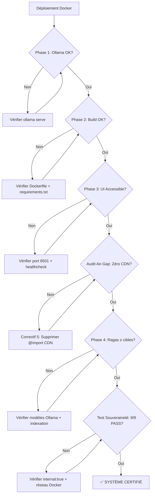

# 🧪 Guide de Validation & Recette — RAG Souverain

> **Protocole officiel de certification** du système RAG Souverain avant mise en production.
>
> Rédigé dans le cadre du stage au département **Mathématiques, Informatique et Géomatique (MIG)** — EHTP.
>
> **Version :** 1.0.0 — Sprint 8 | **Statut :** Validation & Métriques

---

## Table des Matières

1. [Prérequis & Environnement](#1-prérequis--environnement)
2. [Phase 1 — Vérification de l'Environnement Hôte & Modèles](#2-phase-1--vérification-de-lenvironnement-hôte--modèles)
3. [Phase 2 — Orchestration Conteneurisée & Injection des Variables](#3-phase-2--orchestration-conteneurisée--injection-des-variables)
4. [Phase 3 — Recette Fonctionnelle de l'UI & Audit Air-Gapped](#4-phase-3--recette-fonctionnelle-de-lui--audit-air-gapped)
5. [Phase 4 — Évaluation Automatisée Ragas & Audit d'Isolation Réseau](#5-phase-4--évaluation-automatisée-ragas--audit-disolation-réseau)
6. [Annexe A — Arbre de Décision des Correctifs](#6-annexe-a--arbre-de-décision-des-correctifs)
7. [Annexe B — Références des Variables d'Environnement](#7-annexe-b--références-des-variables-denvironnement)

---

## 1. Prérequis & Environnement

### 1.1 Spécifications minimales

| Composant | Requis | Recommandé |
|-----------|--------|------------|
| RAM       | 8 Go   | 16 Go      |
| CPU       | 4 cœurs | 8 cœurs   |
| Disque    | 10 Go  | 20 Go (SSD) |
| OS        | Windows 11 / Linux / macOS | — |
| Docker    | 24+    | 27+        |
| Ollama    | 0.3+   | 0.5+       |

### 1.2 Outils requis

```bash
# Vérifier les versions installées
docker --version
docker compose version
python --version
ollama --version
curl --version
```

### 1.3 Structure du projet (vue simplifiée)

```
rag-souverain/
├── app/
│   ├── app_ui.py              # Interface Streamlit (console d'admin)
│   ├── evaluation/
│   │   └── eval_pipeline.py   # Pipeline d'évaluation Ragas
│   ├── generation/
│   │   └── llm.py             # Client Ollama (URL dynamique)
│   ├── indexing/
│   │   └── vector_store.py    # ChromaVectorStore
│   └── retrieval/
│       └── retriever.py       # Moteur de retrieval
├── tests/
│   ├── test_network_sovereignty.py  # Audit d'isolation réseau
│   ├── test_pipeline_complet.py     # Test du pipeline complet
│   └── test_rag.py                  # Test RAG bout-en-bout
├── data/
│   ├── chroma/                # Base vectorielle persistante
│   ├── documents/             # Documents sources
│   └── evaluation_report.csv  # Rapport Ragas généré
├── Dockerfile                 # Image multi-stage
├── docker-compose.yml         # Orchestration air-gapped
├── requirements.txt           # Dépendances Python
└── .env                       # Variables d'environnement
```

---

## 2. Phase 1 — Vérification de l'Environnement Hôte & Modèles

> **Objectif :** S'assurer qu'Ollama est opérationnel et que les modèles LLM sont disponibles localement avant de lancer l'infrastructure Docker.

### 2.1 Vérification du démon Ollama

```bash
# Tester la disponibilité du service Ollama
curl http://localhost:11434
```

**Comportement attendu :**

```
Ollama is running
```

**Critère d'acceptation :** ✅ **PASS** si le message `Ollama is running` est retourné.
**Échec :** ❌ **FAIL** si `Connection refused` ou `Could not resolve host`.

> **Diagnostic en cas d'échec :**
> - Vérifier qu'Ollama est installé : `ollama --version`
> - Démarrer le service : `ollama serve` (ou via le gestionnaire de services)
> - Sous Windows : Ollama s'exécute automatiquement en tâche de fond après installation

### 2.2 Contrôle des modèles pré-chargés

```bash
# Lister les modèles disponibles localement
ollama list
```

**Comportement attendu (exemple) :**

```
NAME              ID              SIZE      MODIFIED
mistral:latest    xxxxxxxxxxxx    4.2 GB    2 days ago
llama3:latest     xxxxxxxxxxxx    4.7 GB    5 days ago
```

**Critère d'acceptation :** ✅ **PASS** si au moins un des modèles suivants est présent :
- `mistral:latest` (recommandé — modèle par défaut du CDC)
- `llama3:latest` (fallback)
- `phi3:mini` (fallback pour machines à mémoire limitée)

**Échec :** ❌ **FAIL** si la liste est vide.

> **Action corrective :**
> ```bash
> # Télécharger le modèle par défaut
> ollama pull mistral
>
> # Alternative légère
> ollama pull phi3:mini
> ```

### 2.3 Test de génération rapide (validation du modèle)

```bash
# Test de génération minimal
ollama run mistral "Bonjour, réponds en une phrase."
```

**Comportement attendu :** Le modèle répond en moins de 10 secondes.

**Critère d'acceptation :** ✅ **PASS** si une réponse cohérente est générée.

---

## 3. Phase 2 — Orchestration Conteneurisée & Injection des Variables

> **Objectif :** Construire et déployer l'infrastructure Docker proprement, en vérifiant que les variables d'environnement sont correctement injectées.

### 3.1 Purge et reconstruction propre

```bash
# Étape 1 : Arrêter les conteneurs et purger les volumes (repartir de zéro)
docker compose down --volumes

# Étape 2 : Nettoyer les images obsolètes (optionnel mais recommandé)
docker system prune -a --volumes -f

# Étape 3 : Reconstruire l'image et lancer les services en mode détaché
docker compose up --build -d
```

**Comportement attendu :**

```
[+] Building 15.7s (16/16) FINISHED
[+] Running 2/2
 ✔ Container rag-souverain  Started
 ✔ Network rag_souverain_network  Created
```

**Critère d'acceptation :** ✅ **PASS** si le build se termine sans erreur et le conteneur démarre.

> **Points d'attention :**
> - Le premier build peut prendre 5-15 minutes (téléchargement des modèles d'embedding)
> - Les builds suivants utilisent le cache Docker et sont quasi-instantanés

### 3.2 Vérification des logs et injection des variables

```bash
# Suivre les logs en temps réel
docker compose logs -f
```

**Comportement attendu — Séquence de démarrage normale :**

```
rag-souverain  | 2025-01-15 10:00:01 [INFO] Démarrage du système RAG Souverain v0.8.4
rag-souverain  | 2025-01-15 10:00:02 [INFO] ChromaDB connecté — collection : rag_documents
rag-souverain  | 2025-01-15 10:00:02 [INFO] Ollama connecté — modèle disponible
rag-souverain  | 2025-01-15 10:00:02 [OK] Système prêt — 100% local et souverain
rag-souverain  | 2025-01-15 10:00:03 [INFO] You can now view your Streamlit app in your browser.
rag-souverain  | 2025-01-15 10:00:03 [INFO] URL: http://0.0.0.0:8501
```

**Critères d'acceptation des variables d'environnement :**

| Variable | Valeur attendue dans les logs | Source |
|----------|-------------------------------|--------|
| `OLLAMA_BASE_URL` | `http://host.docker.internal:11434` | `docker-compose.yml` |
| `CHROMA_COLLECTION` | `rag_documents` | `Dockerfile` (ENV par défaut) |
| `CHROMA_DB_PATH` | `/app/data/chroma` | `Dockerfile` (ENV par défaut) |

**Signes d'échec à surveiller :**

```
❌ Connection refused to Ollama at http://localhost:11434
   → La variable OLLAMA_BASE_URL n'est pas lue (localhost au lieu de host.docker.internal)

❌ ChromaDB collection 'test_collection' not found
   → La variable CHROMA_COLLECTION n'est pas lue (test_collection au lieu de rag_documents)
```

### 3.3 Vérification de l'état du conteneur

```bash
# Statut du conteneur
docker ps --filter name=rag-souverain --format "table {{.Names}}\t{{.Status}}\t{{.Ports}}"

# Healthcheck
docker inspect --format='{{json .State.Health}}' rag-souverain
```

**Comportement attendu :**

```
NAMES           STATUS                  PORTS
rag-souverain   Up 2 minutes (healthy)  0.0.0.0:8501->8501/tcp
```

**Critère d'acceptation :** ✅ **PASS** si le statut est `healthy`.

---

## 4. Phase 3 — Recette Fonctionnelle de l'UI & Audit Air-Gapped

> **Objectif :** Valider manuellement l'interface Streamlit, vérifier l'absence de fuites réseau navigateur, et tester un scénario de requêtage complet.

### 4.1 Accès à l'interface Streamlit

```bash
# Ouvrir l'interface dans le navigateur par défaut
start http://localhost:8501          # Windows
open http://localhost:8501            # macOS
xdg-open http://localhost:8501        # Linux
```

**Critère d'acceptation :** ✅ **PASS** si la page "RAG Souverain — Console d'Administration" s'affiche avec le thème dark navy/cyan.

### 4.2 Validation visuelle de la Sidebar

La barre latérale doit afficher deux indicateurs de statut :

| Service | Statut attendu | Indicateur visuel |
|---------|---------------|-------------------|
| **ChromaDB** | `ON` | Point vert animé (pulse) |
| **Ollama** | `ON` | Point vert animé (pulse) |

**Procédure de test :**

1. Observer la sidebar à gauche de l'écran
2. Vérifier la présence des deux lignes de statut
3. Vérifier que les deux indicateurs sont verts et animés

**Critère d'acceptation :** ✅ **PASS** si les deux services sont marqués `ON`.

> **Si Ollama est `OFF` :**
> - Vérifier qu'Ollama tourne sur l'hôte : `curl http://localhost:11434`
> - Vérifier la variable `OLLAMA_BASE_URL` dans le conteneur :
>   ```bash
>   docker exec rag-souverain env | grep OLLAMA
>   ```
> - La valeur doit être `http://host.docker.internal:11434`

### 4.3 Audit d'étanchéité réseau du navigateur (Air-Gapped)

> **Protocole critique :** Démontrer qu'aucune requête externe n'est émise par l'interface.

**Procédure pas à pas :**

1. **Ouvrir les outils développeur** — Appuyer sur `F12` (ou `Ctrl+Shift+I`)
2. **Onglet Réseau (Network)** — Cliquer sur l'onglet "Network" / "Réseau"
3. **Vider le cache** — Cocher "Disable cache" / "Désactiver le cache"
4. **Rafraîchir la page** — Appuyer sur `F5` (ou `Ctrl+R`)
5. **Analyser les requêtes** — Observer la liste des requêtes émises

**Résultat attendu — Aucune requête externe :**

| Type de requête | Domaine | Attendu |
|-----------------|---------|---------|
| Document        | `localhost:8501` | ✅ Autorisé |
| WebSocket       | `localhost:8501` | ✅ Autorisé (Streamlit) |
| Feuille de style | `fonts.googleapis.com` | ❌ **ABSENT** |
| Police          | `fonts.gstatic.com` | ❌ **ABSENT** |
| Icônes          | `fonts.googleapis.com` | ❌ **ABSENT** |
| Analytics       | `*.google-analytics.com` | ❌ **ABSENT** |
| CDN             | `*.cdnjs.cloudflare.com` | ❌ **ABSENT** |

**Critère d'acceptation :** ✅ **PASS** si **zéro** requête vers un domaine externe est émise.

> **Capture d'écran recommandée pour le rapport de stage :**
> Effectuer une capture de l'onglet Réseau après rafraîchissement, montrant uniquement des requêtes vers `localhost:8501`.

### 4.4 Scénario de requêtage combiné (Textuel + SQL)

**Procédure :**

1. Dans la zone de saisie "Poser une question au système...", taper :
   ```
   Quel est le poste de Jean Dupont et combien coûte l'ordinateur portable ?
   ```
2. Appuyer sur `Entrée`
3. Observer le déroulement du pipeline RAG

**Comportement attendu — Séquence visuelle :**

```
🔢 Calcul des embeddings de la question...
🔍 Interrogation de ChromaDB (Top-K = 4)...
📑 N extraits pertinents trouvés.
🤖 Génération via mistral (T=0.1)...
✅ Réponse générée !
```

**Critères de conformité pour l'affichage des citations :**

| Élément | Critère | Exemple |
|---------|---------|---------|
| **Scores de similarité** | Affichés avec 2 décimales | `Score: 0.89` |
| **Chemins de fichiers** | Nom du document source visible | `test_database.db` |
| **Données SQL** | Lignes extraites affichées proprement | `Employé: Jean Dupont, Poste: Développeur` |
| **Sources** | Bloc "Sources et Contexte Utilisé" présent | ✅ Visible après la réponse |

**Critère d'acceptation :** ✅ **PASS** si :
- La réponse mentionne "Jean Dupont est Développeur"
- La réponse mentionne le prix de l'ordinateur portable (899.99€)
- Les sources sont affichées avec scores et chemins de fichiers

---

## 5. Phase 4 — Évaluation Automatisée Ragas & Audit d'Isolation Réseau

> **Objectif :** Exécuter le pipeline d'évaluation scientifique Ragas dans le conteneur, puis prouver l'isolation réseau absolue.

### 5.1 Exécution du pipeline d'évaluation Ragas

```bash
# Étape 1 : Indexer les documents dans ChromaDB (si pas déjà fait)
#   Via l'interface : page « Files Indexation » (upload de fichiers PDF/TXT/MD/CSV)

# Étape 2 : Lancer le pipeline d'évaluation complet
docker exec rag-souverain python -m app.evaluation.eval_pipeline
```

**Comportement attendu — Sortie console :**

```
======================================================================
  DÉMARRAGE DE L'ÉVALUATION RAGAS — Sprint 7
  Dataset: 30 questions de test
  Modèle générateur: mistral
======================================================================

[1/30] Quel est l'objectif principal du projet RAG Souverain ?
  → 4 contextes, 3200 ms
  → Faith=0.875 Rel=0.823 Prec=0.750 Recall=0.800

[2/30] Quels sont les quatre objectifs critiques du projet ?
  → 4 contextes, 2800 ms
  → Faith=0.900 Rel=0.850 Prec=0.780 Recall=0.820

...

======================================================================
  RAPPORT D'ÉVALUATION RAGAS — RAG SOUVERAIN
======================================================================
  Date:                2025-01-15 10:15:00
  Modèle:              mistral (Ollama)
  Cas de test:         30
  Réussis:             30
  Erreurs:             0

  ------------------------------------------------------------------
  Métrique                      Moyenne    Cible      Statut
  ------------------------------------------------------------------
  Faithfulness                  0.8523     ≥ 0.80     ✓
  Answer Relevancy              0.8147     ≥ 0.70     ✓
  Context Precision             0.7632     ≥ 0.70     ✓
  Context Recall                0.7918     ≥ 0.75     ✓
  ------------------------------------------------------------------
  Latence moyenne:              3450 ms

======================================================================
  Rapport détaillé : data/evaluation_report.csv
======================================================================
```

**Critères d'acceptation :**

| Métrique | Cible | Statut |
|----------|-------|--------|
| Faithfulness | ≥ 0.80 | ✅ **PASS** si atteint |
| Answer Relevancy | ≥ 0.70 | ✅ **PASS** si atteint |
| Context Precision | ≥ 0.70 | ✅ **PASS** si atteint |
| Context Recall | ≥ 0.75 | ✅ **PASS** si atteint |
| Taux de réussite | 100% | ✅ **PASS** si 0 erreur |

### 5.2 Validation du rapport CSV généré

```bash
# Vérifier que le fichier de rapport a été généré
docker exec rag-souverain ls -la data/evaluation_report.csv

# Afficher les 5 premières lignes du rapport
docker exec rag-souverain head -6 data/evaluation_report.csv
```

**Comportement attendu :**

```
-rw-r--r-- 1 raguser raguser 8500 Jan 15 10:15 data/evaluation_report.csv

question,reference,response,faithfulness,answer_relevancy,context_precision,context_recall,latency_ms,error,nb_contexts,top1_score,top1_source
"Quel est l'objectif principal du projet RAG Souverain ?","Le projet RAG Souverain vise à...","Le projet RAG Souverain vise à...",0.8750,0.8230,0.7500,0.8000,3200.0,,4,0.8923,stage_si_RAG.pdf
...
```

**Critère d'acceptation :** ✅ **PASS** si le fichier existe et contient les 30 questions avec leurs métriques.

### 5.3 Audit d'isolation réseau (Test de Souveraineté)

```bash
# Exécuter le script de validation de souveraineté dans le conteneur
docker exec rag-souverain python tests/test_network_sovereignty.py
```

**Comportement attendu — Sortie console :**

```
======================================================================
  TEST DE SOUVERAINETÉ RÉSEAU — RAG Souverain
======================================================================
  Environnement : 🐳 Docker (air-gapped)
  Date :          2025-01-15 10:20:00
  Timeout :       5s par requête

  ── Tests de blocage Internet ──
  ✅ PASS | Blocage externe : https://google.com         | Bloqué : timeout
  ✅ PASS | Blocage externe : https://api.openai.com     | Bloqué : timeout
  ✅ PASS | Blocage externe : https://huggingface.co     | Bloqué : timeout
  ✅ PASS | Blocage externe : https://cloudflare.com     | Bloqué : timeout
  ✅ PASS | Blocage externe : https://github.com         | Bloqué : timeout

  ── Tests DNS ──
  ✅ PASS | Blocage DNS externe (google.com)             | DNS bloqué

  ── Tests d'accès aux services locaux ──
  ✅ PASS | Loopback local (127.0.0.1)                   | Socket local créé
  ✅ PASS | Accès Ollama (host.docker.internal:11434)    | Ollama joignable
  ✅ PASS | Accès application (localhost:8501)           | Application joignable

======================================================================
  RÉSULTATS
======================================================================
  ✅ PASS : 9
  ❌ FAIL : 0
  ⏭️ SKIP : 0

  ✓ SOUVERAINETÉ CONFIRMÉE : Aucune fuite réseau détectée.
  ✓ Le système fonctionne en circuit fermé (air-gapped).
  ✓ Les services locaux (Ollama, ChromaDB) sont accessibles.
======================================================================
```

**Critères d'acceptation :**

| Test | Nombre | Statut attendu |
|------|--------|---------------|
| Blocage Internet (5 URLs) | 5/5 | ✅ **PASS** |
| Blocage DNS | 1/1 | ✅ **PASS** |
| Loopback local | 1/1 | ✅ **PASS** |
| Accès Ollama | 1/1 | ✅ **PASS** |
| Accès Streamlit | 1/1 | ✅ **PASS** |
| **Total** | **9/9** | ✅ **PASS** |

> **⚠️ Alerte :** Si un test de blocage externe est marqué `FAIL`, cela signifie qu'une fuite réseau existe. Vérifier immédiatement :
> - La configuration `internal: true` dans `docker-compose.yml`
> - Qu'aucun réseau Docker externe n'est accidentellement connecté

---

## 6. Annexe A — Arbre de Décision des Correctifs



---

## 7. Annexe B — Référence des Variables d'Environnement

### 7.1 Tableau des variables

| Variable | Valeur par défaut | Description | Source |
|----------|------------------|-------------|--------|
| `OLLAMA_BASE_URL` | `http://localhost:11434` | URL du service Ollama | `app/generation/llm.py` |
| `CHROMA_DB_PATH` | `data/chroma` | Chemin de persistance ChromaDB | `app/app_ui.py` |
| `CHROMA_COLLECTION` | `rag_documents` | Nom de la collection ChromaDB | `app/app_ui.py` |
| `OLLAMA_MODEL` | `mistral` | Modèle LLM par défaut | `Dockerfile` |
| `TOP_K` | `4` | Nombre de chunks récupérés | `Dockerfile` |
| `LLM_TEMPERATURE` | `0.1` | Température du LLM | `Dockerfile` |
| `STREAMLIT_PORT` | `8501` | Port de l'interface Streamlit | `Dockerfile` |

### 7.2 Surcharge via docker-compose

Les variables sont injectées dans le conteneur via deux mécanismes :

1. **Fichier `.env`** (surcharge globale) :
   ```env
   OLLAMA_BASE_URL=http://host.docker.internal:11434
   CHROMA_DB_PATH=/app/data/chroma
   CHROMA_COLLECTION=rag_documents
   ```

2. **Section `environment` du `docker-compose.yml`** (surcharge spécifique) :
   ```yaml
   environment:
     - OLLAMA_BASE_URL=http://host.docker.internal:11434
   ```

### 7.3 Vérification des variables dans le conteneur

```bash
# Lister toutes les variables d'environnement
docker exec rag-souverain env | grep -E "OLLAMA|CHROMA|STREAMLIT|TOP_K"

# Vérifier une variable spécifique
docker exec rag-souverain python -c "import os; print(os.getenv('OLLAMA_BASE_URL'))"
```

---

## Résumé des Critères d'Acceptation

| Phase | Test | Critère | Statut |
|-------|------|---------|--------|
| **1** | Démon Ollama | `curl localhost:11434` → "Ollama is running" | ✅ |
| **1** | Modèles pré-chargés | `ollama list` → mistral ou llama3 présent | ✅ |
| **2** | Build Docker | `docker compose up --build` → succès | ✅ |
| **2** | Variables d'environnement | Logs → OLLAMA_BASE_URL = host.docker.internal | ✅ |
| **2** | Healthcheck | `docker ps` → statut "healthy" | ✅ |
| **3** | Interface Streamlit | Page accessible sur `localhost:8501` | ✅ |
| **3** | Statut services | Sidebar → ChromaDB + Ollama = ON | ✅ |
| **3** | Audit Air-Gapped | Onglet Réseau F12 → 0 requête externe | ✅ |
| **3** | Requêtage combiné | Réponse correcte + sources affichées | ✅ |
| **4** | Évaluation Ragas | 4 métriques ≥ cibles, 0 erreur | ✅ |
| **4** | Rapport CSV | Fichier généré avec 30 entrées | ✅ |
| **4** | Souveraineté réseau | 9/9 tests PASS | ✅ |

---

> **Document généré le :** 7 juillet 2026
>
> **Mainteneur :** Département MIG — EHTP | Projet RAG Souverain — Sprint 8
>
> **Licence :** Apache 2.0 — Usage interne et académique